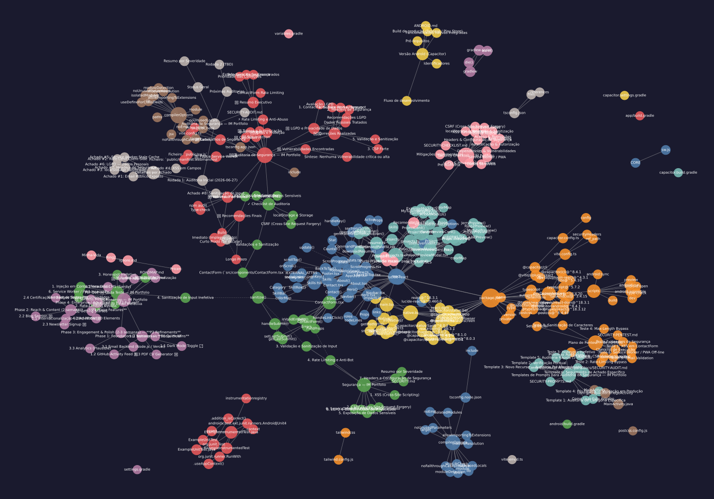

  <picture>
    <source media="(prefers-color-scheme: dark)" srcset="https://shieldcn.dev/header/graph.svg?title=Ant%C3%B3nio+Mendes&subtitle=Applied+AI+Engineer+%7C+Portf%C3%B3lio+Pessoal%2C+Tecnologia+e+Projetos&logo=github&theme=blue&mode=dark" />
    
  </picture>

  
  
  
  

---

Portfólio interativo e memorial descritivo da jornada técnica, desafios superados e produtos construídos por António Mendes — Applied AI Engineer & Systems Architect.

---

## 🗺️ Mapa Arquitetural & Grafo de Dependências

Grafo estrutural e comunidades extraído via [graphify](https://github.com/Graphify-Labs/graphify):

- 📊 **Relatório Arquitetural:** [graphify-out/GRAPH_REPORT.md](./graphify-out/GRAPH_REPORT.md)
- 🌐 **Navegador Interativo (HTML):** Abra [`graphify-out/graph.html`](./graphify-out/graph.html) no navegador
- 🔀 **Fluxo de Chamadas & Diagramas:** Abra [`graphify-out/Minha-vida-callflow.html`](./graphify-out/Minha-vida-callflow.html) para diagramas Mermaid
